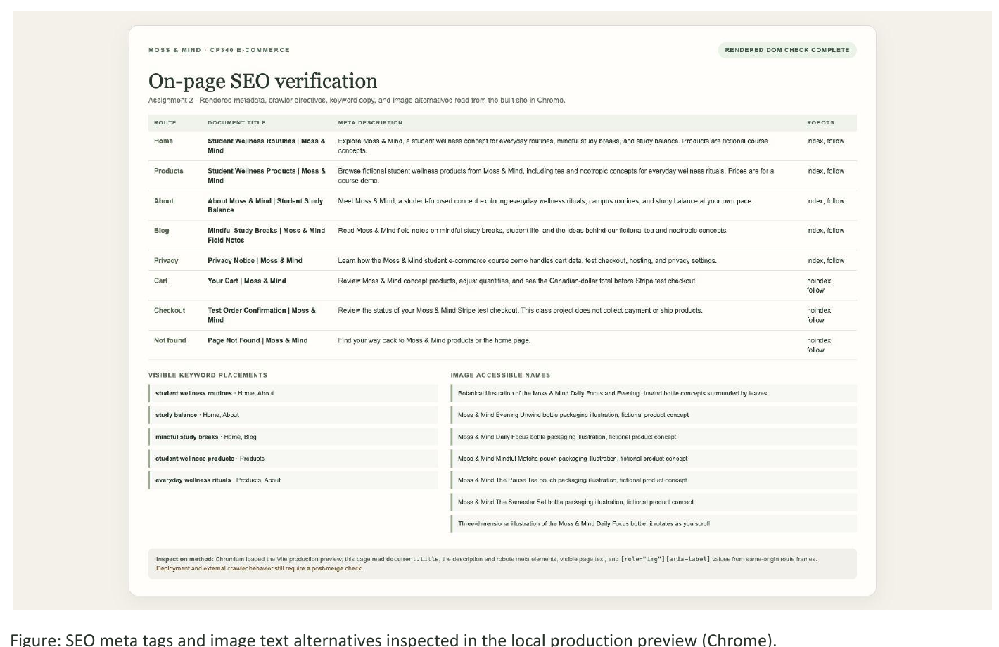

# Moss & Mind SEO report section

## Target phrases and placement

These phrases describe the student-focused concept and its existing content. They appear in reader-facing copy where relevant; they are not repeated as hidden keyword tags.

| Target phrase             | Pages used      | Context                                                                |
| ------------------------- | --------------- | ---------------------------------------------------------------------- |
| student wellness routines | Home, About     | Describes the brand's focus on small, student-centered routines.       |
| study balance             | Home, About     | Frames the site's message around making room for a student's own pace. |
| mindful study breaks      | Home, Blog      | Used for the everyday pause and field-note content.                    |
| student wellness products | Products        | Identifies the fictional tea and nootropic product concepts.           |
| everyday wellness rituals | Products, About | Describes the tea concepts and the habits behind the collection.       |

## On-page metadata

The home route has matching static HTML metadata for the first page load. `RouteEffects` updates the title, description, and robots directive when users navigate between client-rendered routes.

| Page                                 | Meta title                                      | Meta description                                                                                                                                               |
| ------------------------------------ | ----------------------------------------------- | -------------------------------------------------------------------------------------------------------------------------------------------------------------- |
| Home `/`                             | Student Wellness Routines \| Moss & Mind        | Explore Moss & Mind, a student wellness concept for everyday routines, mindful study breaks, and study balance. Products are fictional course concepts.        |
| Products `/collection`               | Student Wellness Products \| Moss & Mind        | Browse fictional student wellness products from Moss & Mind, including tea and nootropic concepts for everyday wellness rituals. Prices are for a course demo. |
| About `/about`                       | About Moss & Mind \| Student Study Balance      | Meet Moss & Mind, a student-focused concept exploring everyday wellness rituals, campus routines, and study balance at your own pace.                          |
| Blog `/blog`                         | Mindful Study Breaks \| Moss & Mind Field Notes | Read Moss & Mind field notes on mindful study breaks, student life, and the ideas behind our fictional tea and nootropic concepts.                             |
| Privacy `/privacy`                   | Privacy Notice \| Moss & Mind                   | Learn how the Moss & Mind student e-commerce course demo handles cart data, test checkout, hosting, and privacy settings.                                      |
| Cart `/cart`                         | Your Cart \| Moss & Mind                        | Review Moss & Mind concept products, adjust quantities, and see the Canadian-dollar total before Stripe test checkout.                                         |
| Checkout success `/checkout/success` | Test Order Confirmation \| Moss & Mind          | Review the status of your Moss & Mind Stripe test checkout. This class project does not collect payment or ship products.                                      |
| Checkout canceled `/checkout/cancel` | Checkout Paused \| Moss & Mind                  | Return to the Moss & Mind collection after leaving the Stripe test checkout. This class project does not collect payment.                                      |
| Not found                            | Page Not Found \| Moss & Mind                   | Find your way back to Moss & Mind products or the home page.                                                                                                   |

Titles and descriptions are distinct by route, explain the page content, and avoid health or efficacy claims about fictional products.

## Image alternatives

The site has no raster `` elements. Product packaging and the home artwork are CSS/inline-SVG illustrations; the About product visual is a 3D canvas with an illustration fallback. Meaningful visuals use `role="img"` and an accessible name as the text alternative. Decorative SVGs are hidden from assistive technology.

- Product cards and hero bottles: `Moss & Mind Daily Focus bottle packaging illustration, fictional product concept` (the product name and bottle/pouch format change with each item).
- Home hero artwork: `Botanical illustration of the Moss & Mind Daily Focus and Evening Unwind bottle concepts surrounded by leaves`.
- About visual: `Three-dimensional illustration of the Moss & Mind Daily Focus bottle; it rotates as you scroll`.

## Verification checklist

- [x] Five accurate target phrases are listed with the pages where visible copy uses them.
- [x] Each route has a specific title and description; the initial home document includes its own title and description before React loads.
- [x] Public informational pages use `index, follow`; cart, checkout result, and not-found routes use `noindex, follow`.
- [x] The site-wide `X-Robots-Tag: noindex, nofollow` header was removed so it no longer blocks public-page indexing.
- [x] Meaningful product and page illustrations have descriptive accessible text alternatives; decorative artwork is marked hidden.
- [x] Review the HTML shell, route metadata, robots directives, visible copy, image labels, and Vercel response headers.
- [x] Check the rendered production preview in Chrome and capture the metadata, keyword, robots, and image-label results below.
- [ ] After merge and deployment, recheck the public site metadata and crawler directives.

**Inspection method:** `npm run build` succeeded. Chrome loaded the local production preview, and a same-origin inspection page read `document.title`, description and robots meta elements, visible text, and `[role="img"][aria-label]` values for Home, Products, About, Blog, Privacy, Cart, Checkout, and Not Found. The visible keyword phrases and seven image labels matched the expected pages and source. External crawler behavior still needs a post-merge check.

**Evidence screenshot:**

## Relevant code changes

- `index.html`: indexable home robots directive, home title, and description.
- `src/app/RouteEffects.tsx`: per-route titles, descriptions, and robots directives.
- `src/features/home/components/Hero.tsx`, `src/features/catalog/CollectionPage.tsx`, `src/features/about/AboutPage.tsx`, and `src/features/blog/BlogPage.tsx`: natural keyword placement in visible copy.
- `src/features/catalog/components/ProductIllustration.tsx` and `src/features/about/BottleScene.tsx`: descriptive text alternatives for the product illustrations.
- `vercel.json` and `src/features/privacy/PrivacyPage.tsx`: removed the conflicting crawler exclusion and documented the current indexing behavior.
